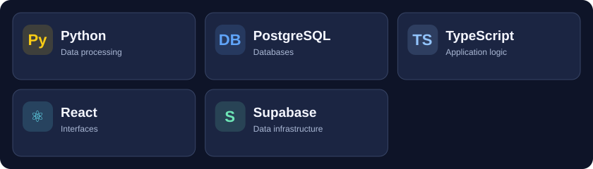

# Hi, I'm Anna 👋

**Business Intelligence · Data Analytics · AI & Automation**

  
  

---

## About me

I'm focused on **Business Intelligence and Data Analytics**, connecting data, technology and business needs to turn information into actionable insights. I also explore **AI, automation and digital products** to create practical, data-driven solutions.

- 📊 **Analytics & BI:** dashboards, KPIs and business-oriented analysis
- 🗄️ **Data:** SQL, relational databases and data exploration
- ⚙️ **Technology:** automation, APIs and AI-enabled applications
- 🎯 **Mindset:** turning complex information into clear decisions

## Tech & tools

**Analytics & BI**

**Data & development**

## Featured projects

### ✈️ Aerometrics — Aviation data analytics

**Business Intelligence / aviation analytics project** focused on using data to support strategic analysis and clearer decision-making. The project explores aviation indicators, analytical workflows and data visualization.

**Stack:** `Python` · `SQL` · `Power BI` *(adjust to match your exact contribution)*

🔗 **[View Aerometrics project]((https://github.com/GabrielVieiraDL/aerometrics-dashboard))**

### 💜 [Her Way — Digital learning & career platform](https://github.com/Callejonjon/Projeto_Her_Way)

A technology project combining product development, data infrastructure and AI-enabled features to support professional learning and access to opportunities.

**Stack:** `Next.js` · `React` · `TypeScript` · `Supabase` · `PostgreSQL` · `APIs`

---

## Let's connect

Interested in BI, analytics and technology? Let's connect.

💼 [LinkedIn](https://www.linkedin.com/in/anna-beatriz-callejon/) · ✉️ [Email](mailto:callejoncontato@gmail.com)
